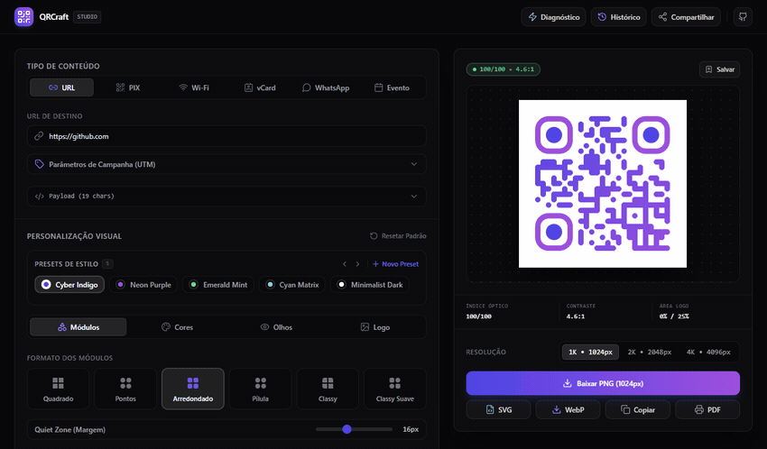

# QRCraft Studio

> **Estúdio de engenharia e diagnóstico óptico de QR Codes com execução 100% no cliente. Construtor de payloads em conformidade com o padrão EMVCo/PIX BACEN, cálculo polinomial de redundância cíclica CRC16-CCITT, termômetro de escaneabilidade em tempo real e exportação gráfica em alta resolução.**

<p align="center">
  <a href="https://pedrobosa.github.io/QRCraft/"></a>
  <a href="LICENSE"></a>
  <a href="https://github.com/PedroBosa"></a>
</p>

<p align="center">
  
  
  
  
  
</p>

<p align="center">
  
</p>

---

## Visão geral

O **QRCraft** é uma ferramenta para geração, parametrização estética e validação computacional de códigos bidimensionais (QR Code padrão ISO/IEC 18004).

A maior parte dos serviços web de geração de QR Codes introduz vulnerabilidades operacionais e de privacidade: redirecionamentos arbitrários por meio de URLs intermediárias encurtadas, envio de credenciais de acesso ou dados bancários para servidores desconhecidos, inserção compulsória de logotipos comerciais e rasterização em baixa resolução inviável para aplicação gráfica industrial.

O QRCraft processa toda a compilação de payloads, desenho vetorial dos módulos e diagnóstico óptico diretamente na memória do navegador do usuário. A aplicação opera sem componentes de backend, sem transmissão de telemetria e sem dependência de serviços externos para compor ou validar os códigos gerados.

---

## Destaques de engenharia

### 1. Construtor de payloads EMVCo / PIX (Banco Central do Brasil)
A geração de códigos para pagamentos instantâneos (PIX) implementa rigorosamente a especificação do manual de padrões do Banco Central do Brasil baseada no formato internacional EMVCo (*EMV Integrated Circuit Card Specifications for Payment Systems*).

A estrutura opera sobre o modelo de dados TLV (*Tag-Length-Value*), onde cada elemento possui um identificador numérico de 2 dígitos, um indicador de comprimento de 2 dígitos e o conteúdo serializado:

$$\text{Campo TLV} = \text{Tag}_{(2)} \,\|\, \text{Tamanho}_{(2)} \,\|\, \text{Valor}_{(N)}$$

O payload estático consolida os seguintes nós normativos:
- **Tag 00 (Payload Format Indicator):** valor constante `01`.
- **Tag 26 (Merchant Account Information):** subtag `00` (`br.gov.bcb.pix`), subtag `01` (chave PIX normalizada de acordo com seu domínio: dígitos brutos para CPF/CNPJ, padrão internacional E.164 `+55...` para telefones móveis, minúsculas para e-mail ou UUID padrão para EVP) e subtag opcional `02` (descrição informativa sanitizada, máx. 40 caracteres).
- **Tag 52 (Merchant Category Code):** código `0000` (padrão genérico).
- **Tag 53 (Transaction Currency):** código numérico ISO 4217 `986` (Real Brasileiro - BRL).
- **Tag 54 (Transaction Amount):** valor decimal com 2 casas de precisão (quando estipulado).
- **Tag 58 (Country Code):** `BR`.
- **Tag 59 (Merchant Name):** nome do recebedor sanitizado contra caracteres especiais e acentuações (máx. 25 caracteres).
- **Tag 60 (Merchant City):** município de registro (máx. 15 caracteres).
- **Tag 62 (Additional Data Field):** subtag `05` contendo o Identificador da Transação (TxID), aplicando `***` em identificadores anônimos.
- **Tag 63 (CRC-16 Checksum):** preenchido com a assinatura matemática de 4 caracteres hexadecimais descrita a seguir.

### 2. Algoritmo polinomial CRC-16-CCITT
A integridade da cadeia de pagamento EMV é autenticada através do polinômio gerador padrão CCITT-FALSE com parâmetros:
- **Polinômio:** $P(x) = x^{16} + x^{12} + x^5 + 1 \equiv \text{0x1021}$
- **Valor inicial:** $\text{0xFFFF}$
- **Operação de deslocamento:** shift à esquerda (*MSB-first*)
- **Tamanho do campo:** 16 bits (4 caracteres hexadecimais em maiúsculas)

O processo de cálculo itera sobre cada caractere $c$ do payload antecedido pelo prefixo `6304`:

$$\text{crc} \leftarrow \text{crc} \oplus (c \ll 8)$$

Para cada um dos 8 bits:

$$\text{crc} \leftarrow \begin{cases} (\text{crc} \ll 1) \oplus \text{0x1021}, & \text{se } (\text{crc} \ \& \ \text{0x8000}) \ne 0 \\[6pt] \text{crc} \ll 1, & \text{caso contrário} \end{cases}$$

O valor final de 16 bits é mascarado com $\text{0xFFFF}$ e formatado como string hexadecimal de 4 dígitos com preenchimento à esquerda (`padStart(4, '0')`).

### 3. Modelo de diagnóstico óptico de escaneabilidade
O sistema executa auditoria sintética contínua sobre a configuração geométrica e visual do código:

**Contraste óptico WCAG 2.1 no pior caso de gradientes:**  
Para códigos com gradientes multiponto, todos os pontos de cor de primeiro plano ($\text{fg}_i$) e fundo ($\text{bg}_j$) têm sua luminância relativa calculada:

$$C_{\text{lin}} = \begin{cases} \dfrac{C}{12.92}, & C \le 0.03928 \\[8pt] \left( \dfrac{C + 0.055}{1.055} \right)^{2.4}, & C > 0.03928 \end{cases}$$

$$Y = 0.2126 R_{\text{lin}} + 0.7152 G_{\text{lin}} + 0.0722 B_{\text{lin}}$$

A razão de contraste $C_r$ entre cada par é computada:

$$C_r(\text{fg}_i, \text{bg}_j) = \frac{\max(Y_{\text{fg}}, Y_{\text{bg}}) + 0.05}{\min(Y_{\text{fg}}, Y_{\text{bg}}) + 0.05}$$

O escore avalia o pior caso absoluto:

$$C_{\text{worst}} = \min_{i, j} C_r(\text{fg}_i, \text{bg}_j)$$

- Se $C_{\text{worst}} < 3.0$: penalidade crítica de $-50$ pontos.
- Se $3.0 \le C_{\text{worst}} < 4.5$: penalidade de $-20$ pontos.
- Se $Y_{\text{fg}} > Y_{\text{bg}}$ (módulos claros sobre fundo escuro): alerta de inversão de polaridade e penalidade de $-30$ pontos por risco de falha em scanners ópticos industriais de código de barras.

**Cobertura do logo central vs. capacidade Reed-Solomon:**  
A inserção de um logotipo central destrói parte da matriz bidimensional, exigindo compensação pelos blocos de correção de erro Reed-Solomon (*Error Correction Level* - ECL). A área de oclusão do logo normalizado em relação ao código é:

$$A_{\text{logo}} = (\text{imageSize})^2$$

Os limites máximos de segurança estrutural recomendados pelo algoritmo são:

$$A_{\text{safe}}(ECL) = \begin{cases} 0.07 \; (7\%), & ECL = \text{L} \\ 0.15 \; (15\%), & ECL = \text{M} \\ 0.25 \; (25\%), & ECL = \text{Q} \\ 0.30 \; (30\%), & ECL = \text{H} \end{cases}$$

Se $A_{\text{logo}} > A_{\text{safe}}$, calcula-se a penalidade proporcional de degradação:

$$\Delta_{\text{excess}} = \frac{A_{\text{logo}} - A_{\text{safe}}}{A_{\text{safe}}}, \qquad P_{\text{logo}} = \min\left(45, \; \lfloor \Delta_{\text{excess}} \cdot 40 \rfloor \right)$$

O escore final de escaneabilidade varia de $0$ a $100$, classificando o código entre *Crítico* ($<45$), *Atenção* ($45$–$69$), *Bom* ($70$–$89$) e *Excelente* ($90$–$100$).

### 4. Validador óptico computacional no cliente
Além da análise matemática estática, o QRCraft embute um pipeline de visão computacional em tempo real acionado pela biblioteca `html5-qrcode`. O validador obtém a matriz de pixels renderizada no `<canvas>` e a submete ao decodificador, confirmando a recuperação sem erro da cadeia binária antes de qualquer impressão ou exportação.

---

## Recursos

- **Compilação de payloads especializados:**
  - **URL / Hyperlink:** construtor parametrizado com injeção de parâmetros UTM (*source*, *medium*, *campaign*, *term*, *content*).
  - **PIX (BR Code):** normalização rigorosa de chaves e geração automática de checksum CRC16.
  - **Wi-Fi:** formato `WIFI:T:...;S:...;P:...;H:...;;` para redes WPA, WPA2, WEP e abertas com opção de SSID oculto.
  - **vCard 3.0:** cartão de contato corporativo (RFC 2426) contendo nome, empresa, cargo, múltiplos telefones, e-mail e URL.
  - **WhatsApp:** links diretos de chat `https://wa.me/` com sanitização telefônica e codificação de mensagem pré-formatada via `encodeURIComponent`.
  - **iCalendar 2.0:** agendamento de eventos corporativos e reuniões em formato UTC (RFC 5545).
- **Estúdio de estilo vetorial:** seleção de geometrias de módulos (quadrado, pontos circulares, cantos arredondados), desenho personalizado dos olhos perimétricos (quadro e pupila com cores independentes) e gradientes lineares/radiais.
- **Pipeline de exportação em múltiplos formatos:**
  - Rasterização de bitmap nos formatos **PNG** e **WebP** em resoluções padronizadas de **1K (1024px)**, **2K (2048px)** e **4K (4096px)**.
  - Geração de código vetorial **SVG** limpo e encapsulado, sem artefatos de DOM, permitindo importação direta em ferramentas de edição gráfica vetorial.
  - Cópia direta da imagem PNG para a área de transferência (`ClipboardItem`).
  - Geração de folhas de impressão em formato **PDF A4** via `jsPDF`, oferecendo dois esquemas de diagramação: Display individual de balcão ou grade $3 \times 4$ contendo 12 adesivos com linhas guias para corte.

---

## Privacidade e segurança

- **Processamento 100% isolado no cliente:** chaves bancárias, senhas de redes Wi-Fi e listas de contatos nunca deixam a máquina do usuário.
- **Sem rastreadores ou redirecionamentos:** os códigos gerados apontam diretamente para o destino especificado, sem o uso de domínios intermediários de monitoramento.
- **Fontes locais:** as declarações de tipografia utilizam a pilha instalada no sistema operacional (`Plus Jakarta Sans`, `Inter`, `JetBrains Mono`), sem comunicação com servidores de fontes externos (Google Fonts ou CDNs).
- **Armazenamento seguro:** históricos de templates e rascunhos são armazenados exclusivamente na chave local do navegador via `localStorage` (`qrcraft-storage`).
- **Validação de câmera segura:** o decodificador computacional opera estritamente na memória volátil de processamento de quadros de vídeo, sem armazenar imagens em disco.

---

## Estrutura do projeto

```text
QRCraft/
├── .github/
│   ├── ISSUE_TEMPLATE/
│   │   ├── bug_report.yml          # Formulário padronizado para relato de bugs
│   │   ├── config.yml              # Configuração de issues e canal de segurança
│   │   └── feature_request.yml     # Formulário padronizado para sugestões
│   ├── workflows/
│   │   ├── ci.yml                  # Validação estática de tipos e build em PRs
│   │   └── deploy.yml              # Build e publicação no GitHub Pages
│   ├── CODEOWNERS                  # Definição de propriedade de código (@PedroBosa)
│   ├── dependabot.yml              # Atualização semanal de dependências npm e actions
│   └── PULL_REQUEST_TEMPLATE.md    # Checklist de verificação para pull requests
├── src/
│   ├── core/                       # Núcleo algorítmico desacoplado de componentes visuais
│   │   ├── algorithms/
│   │   │   ├── crc16.ts            # Cálculo polinomial CRC16-CCITT (0x1021)
│   │   │   ├── luminance.ts        # Cálculo de luminância relativa WCAG 2.1 e contraste
│   │   │   └── scannability.ts     # Modelo de diagnóstico óptico de escaneabilidade
│   │   └── builders/
│   │       ├── emv-pix.ts          # Construtor TLV e sanitizador de payload PIX BACEN
│   │       ├── ical.ts             # Construtor de eventos padrão iCalendar 2.0
│   │       ├── index.ts            # Ponto de exportação de construtores
│   │       ├── utm.ts              # Construtor de parâmetros de rastreamento UTM
│   │       ├── vcard.ts            # Compilador de cartões de contato vCard 3.0
│   │       ├── whatsapp.ts         # Construtor de links diretos para a API do WhatsApp
│   │       └── wifi.ts             # Compilador de protocolo de credenciais Wi-Fi
│   ├── modules/                    # Módulos visuais e painéis do estúdio
│   │   ├── export/                 # Motores de exportação gráfica (PNG, WebP, SVG, PDF A4)
│   │   ├── payload-builder/        # Formulários reativos com máscaras de digitação
│   │   ├── presets-history/        # Gestão de histórico local e modelos pré-definidos
│   │   ├── preview/                # Palco de renderização, termômetro e validador óptico
│   │   └── studio/                 # Controles de estilização de módulos, olhos e logo
│   ├── shared/                     # Componentes utilitários de interface compartilhados
│   ├── store/
│   │   └── useQRStore.ts           # Gerenciamento de estado global com persistência Zustand
│   ├── types/                      # Definições de tipos TypeScript e contratos de domínio
│   ├── App.tsx                     # Componente raiz da aplicação
│   ├── index.css                   # Definições base e classes utilitárias CSS
│   └── main.tsx                    # Inicialização do React 18 no elemento do DOM
├── .editorconfig                   # Padronização de indentação e formatação
├── .gitattributes                  # Normalização de quebras de linha (LF)
├── .gitignore                      # Exclusão de artefatos de compilação e dependências
├── .nvmrc                          # Versão recomendada do Node.js (22)
├── CHANGELOG.md                    # Histórico de alterações seguindo Keep a Changelog
├── CODE_OF_CONDUCT.md              # Código de conduta Contributor Covenant 2.1
├── CONTRIBUTING.md                 # Diretrizes para desenvolvimento e contribuição
├── index.html                      # Ponto de entrada HTML estruturado
├── LICENSE                         # Licença permissiva MIT
├── package.json                    # Metadados e scripts de automação
├── postcss.config.js               # Configuração do PostCSS
├── README.md                       # Documentação técnica central
├── SECURITY.md                     # Diretrizes de segurança e canal confidencial
├── tailwind.config.js              # Configurações de tema e tokens do Tailwind CSS
├── tsconfig.json                   # Configuração estrita do compilador TypeScript
├── tsconfig.node.json              # Configuração TypeScript para ferramentas de build
└── vite.config.ts                  # Configuração do Vite e agrupamento de chunks manuais
```

---

## Primeiros passos

### Pré-requisitos
- Node.js versão 20 LTS ou 22 LTS (verifique com `node --version`).
- npm versão 10 ou superior.

### Instalação e execução
```bash
git clone https://github.com/PedroBosa/QRCraft.git
cd QRCraft
npm ci
npm run dev
```

### Build e verificação
```bash
npm run typecheck
npm run build
npm run preview
```

---

## Compatibilidade

| Navegador / Plataforma | Suporte | Observações |
|---|---|---|
| Google Chrome / Chromium $\ge 108$ | Integral | Aceleração completa de canvas, acesso a câmera via `getUserMedia` e geração 4K. |
| Microsoft Edge $\ge 108$ | Integral | Suporte integral equivalente à plataforma Chromium. |
| Mozilla Firefox $\ge 115$ | Integral | Suporte completo; geração de PDFs de múltiplas páginas com excelente estabilidade. |
| Apple Safari $\ge 16.4$ | Integral | `ClipboardItem` requer contexto seguro (HTTPS/localhost); decodificação de câmera sujeita a permissões do sistema. |
| Dispositivos Móveis | Suporte responsivo | Interface totalmente responsiva; o validador óptico opera diretamente com a câmera traseira do aparelho. |

---

## Stack e tecnologias

| Tecnologia | Versão | Função na arquitetura |
|---|---|---|
| React | 18.3.1 | Renderização declarativa da interface do usuário |
| TypeScript | 5.4.5 | Tipagem estática estrita em toda a base de código |
| Vite | 5.2.11 | Empacotador e servidor de desenvolvimento |
| Zustand | 4.5.2 | Gerenciamento de estado global com middleware de persistência |
| Tailwind CSS | 3.4.3 | Framework utilitário de estilização de interface |
| qr-code-styling | 1.6.0-rc.1 | Motor gráfico para cálculo e renderização customizada dos módulos de QR Code |
| html5-qrcode | 2.3.8 | Motor de visão computacional para decodificação óptica e validação em tempo real |
| jsPDF | 2.5.1 | Mecanismo de diagramação vetorial e geração de folhas de impressão em formato PDF A4 |
| Framer Motion | 11.2.10 | Biblioteca de transições e microinterações de interface |
| Lucide React | 0.383.0 | Conjunto consistente de ícones técnicos de interface |

---

## Limitações conhecidas

- **Contexto seguro para acesso à câmera:** a validação óptica via webcam ou câmera do dispositivo móvel (`html5-qrcode`) exige contexto seguro (protocolo `https://` ou ambiente de desenvolvimento `localhost`), por imposição das especificações de segurança da API `MediaDevices.getUserMedia`.
- **Uso de memória na rasterização 4K:** a exportação em resolução 4K ($4096 \times 4096\text{ px}$) gera um buffer gráfico de aproximadamente $67\text{ MB}$ não comprimido na memória volátil do navegador antes da codificação em PNG, podendo causar engasgos temporários em dispositivos com baixo limite de memória RAM compartilhada.
- **Precisão dimensional em impressão PDF:** a renderização milimétrica de etiquetas e folhas A4 via `jsPDF` pressupõe escala de impressão a $100\%$ no visualizador de PDFs; caso a impressora física aplique redimensionamento do tipo "Ajustar à página" (*Fit to Page*), pode ocorrer variação marginal nas margens externas de corte.

---

## Contribuindo

Contribuições que ampliem a conformidade com normas técnicas ou aprimorem o algoritmo de diagnóstico óptico são bem-vindas. Consulte o guia detalhado em [`CONTRIBUTING.md`](CONTRIBUTING.md) antes de enviar alterações. Relatos de falhas de segurança devem seguir a política em [`SECURITY.md`](SECURITY.md).

---

## Licença

Distribuído sob a licença MIT. Consulte [`LICENSE`](LICENSE) para mais informações.

Desenvolvido por [Pedro Bosa](https://github.com/PedroBosa).
